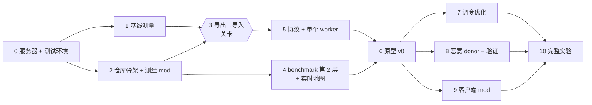

# mc-donate 开发计划

第 0 步已完成并合入 main：2026-11-08，同步上游后 `scripts/test.sh step0` 87 项通过、无 skip，退出码 0，详情见 [验收记录](docs/step0-plan.md)。第 2 步的骨架和 bench mod 已从上游同步，第 1 步的基线测量仍待实施。之后每一步都先写测试再写功能，测试通过才进下一步；前面所有步骤的测试，在后面每一步都要重跑。这里不排时间，只排顺序。

## 步骤总览

- 能并行的：1 和 2；3 和 4；7、8、9。
- 关卡在第 3 步：过不了就切路线 B（Minestom + 自己写的确定性生成器），后面的协议、调度、验证不用改。
- **最小完整版本**：0–6，加上第 7 步的预测调度、第 8 步的作弊开关和随机整块重算。做到这里就能完整回答研究假设。

## 测试约定

每一步的验收都是一条命令，结果只有通过或失败，agent 不用看游戏画面就能判断。入口统一为 `scripts/test.sh stepN`：跑这一步和之前所有步骤的测试，退出码 0 表示通过。

| 测试类型 | 怎么跑 | 测什么 | 例子 |
| --- | --- | --- | --- |
| 单元测试 | Gradle + JUnit，在 Docker 里跑 | 不需要起服务器的纯逻辑：协议编解码、调度、租约 | 消息编码后再解码，内容不变 |
| 服务器内测试 | Fabric GameTest，跑在 `docker compose` 起的服务器里 | 要调用原版代码的逻辑：导出、导入、写入冲突 | 已加载的 chunk 不会被覆盖 |
| 端到端测试 | Python（pytest）+ RCON + 直接读存档 | 整条链路和性能数字 | 导入的 chunk 和原版生成的一样 |

- **存档读取器负责判对错**：一个 Python 小库，直接读 `.mca` 文件，取出某个 chunk 的生成状态、方块和每列的方块 hash。第 0 步就写好，后面所有端到端测试都用它判断结果。
- **对照世界**：同一个 seed 的全新世界里，原版自己生成的同一块区域。判断 donor 生成得对不对，一律和它比，比较时扣除第 1 步测出的原版不确定率。
- **每轮都用全新世界**：脚本自动换一个新的 `MC_LEVEL`，跑完删掉，不在同一个世界上重复测。
- **查日志**：每个端到端测试结束时搜一遍服务器日志，出现 `ERROR` 或异常堆栈就判失败。已知无害的日志列进白名单。
- **慢测试单独跑**：性能测试标成 `slow`，不放进每次的回归，只在当前步骤验收和第 10 步跑。

## 第 0 步：服务器装好，能自动验收（现在在这一步）

目标是一条命令起一台干净的服务器，确认各组件都在，生成一小块地形再从存档里读出来。`docker/compose.yaml` 已经写好；第一次启动前，运行的人需要自己同意 EULA。

要写的：

- `scripts/rcon.sh <命令>`：包一层 `docker compose exec minecraft rcon-cli`，所有测试都通过它发命令。
- `scripts/new_world.sh <名字> <seed>`：停服，改 `MC_LEVEL` 和 `MC_SEED`，启动，等到 healthy。
- `analysis/mca/`：Python 存档读取器。NBT 用现成的库解析，region 文件格式自己写，便于控制。
- `scripts/test.sh` 和 pytest 骨架。

验收：

- [x] 容器状态是 healthy；日志里 Fabric Loader 0.16.14、Fabric API、Carpet、Chunky、spark 都已加载
- [x] RCON 发 `seed` 返回 424242；`spark tps` 和 `chunky help` 都有正常输出
- [x] Carpet 假玩家：`player bot1 spawn` 后 `list` 里有 bot1，`player bot1 kill` 后消失
- [x] Chunky 生成出生点附近一小块方形区域；完成后，读取器能读到其中每个 chunk，状态都是 `minecraft:full`
- [x] 读取器自测：同一个 chunk 读两次 hash 相同；读不存在的 chunk 返回"不存在"，而不是报错
- [x] `new_world.sh` 换新世界后，新世界里只有出生点附近的 chunk
- [x] 停服再启动，世界还在，日志里没有 ERROR

Carpet 的 `player` 命令默认只给 OP 用，RCON 控制台有这个权限，所以测试不用给任何玩家开 OP。

## 第 1 步：基线测量

目标是拿到三个数：每个 chunk 花多少 CPU 毫秒、每秒能生成多少 chunk、原版生成的不确定率。它们决定研究假设里的目标值。这一步不写 mod，只用 Chunky 和脚本。

要写的：

- 找测试区域：用 RCON 发 `locate biome` 找海洋、山地、丛林，把坐标固定写进 `bench/areas.json`，以后都用这三块。
- `bench/layer1.py`：对每个"区域 × 核数（1 / 2 / 4）× 第几次"，换全新世界 → Chunky 生成 16×16 chunk 的方形区域 → 等日志里出现完成 → 记录耗时。CPU 时间从容器 cgroup 的 `cpu.stat` 读，前后相减。
- 不确定率：同一区域在两个全新世界里各生成一次（包括 1 核和 4 核各一次），用读取器逐 chunk、逐列比较 hash。
- 结果写到 `analysis/results/layer1.csv`。

验收：

- [ ] 3 个区域 × 3 种核数 × 5 次全部跑完，没有失败的
- [ ] 同一配置 5 次的吞吐波动小于 10%；超过就先查噪声来源（别的容器、CPU 降频），再继续
- [ ] 不确定率分三档给出：整块完全一样 / 只差几列 / 差很多；差的部分记下是什么方块、在哪一层
- [ ] 把这些数写进 README 的研究假设，先定 X 的初始值

各生成阶段的耗时占比用第 2 步的 bench mod 测：生成前 `scripts/rcon.sh bench reset` 和 `bench timing on`，生成后 `scripts/bench_stages.py` 写出 `analysis/results/stages.csv`。计时前要先预热 JVM；计时本身不影响生成速度（实测差别小于 1%）。

## 第 2 步：仓库骨架和测量 mod

目标是把"写 mod → 构建 → 装进服务器 → 跑测试"这条路打通。第一个 mod 做测量用，后面每一步都要用到它。

要写的：

- Gradle 多模块：`common`、`coordinator`、`worker`、`client`、`bench`。用 Fabric Loom，Mojang 官方名字 + Parchment 参数名。构建在 Docker 里跑，本机不装 Java。
- compose 把构建出来的 mod 挂进容器的 `/mods`，镜像启动时会同步进服务器。
- bench mod：
    - 给每个生成阶段计时（用 Mixin 包住各阶段的生成任务）。
    - 分别统计"新生成的 chunk"和"从磁盘读进来的 chunk"的数量。第 3 步要靠这两个计数判断有没有重复生成。
    - `/bench stats` 把计数和耗时输出成 JSON。
- 能跑 GameTest 的启动方式：compose 里加一个 `test` profile。

验收：

- [x] Docker 里 `./gradlew build` 通过，单元测试通过
- [x] 装上我们的 mod 起服，第 0 步的测试全部仍然通过
- [x] 一个空的 GameTest 能跑并报告通过，证明测试框架本身可用
- [x] Chunky 生成 N 个新 chunk 后，"新生成"计数正好是 N
- [x] 重启后把假玩家传送到已生成的区域："从磁盘读"计数增加，"新生成"计数不变
- [ ] 补上第 1 步缺的各阶段耗时占比（工具已就绪：`/bench stages` 和 `scripts/bench_stages.py`；数据等第 1 步的测试区域定下来再测）

## 第 3 步：手动打通导出 → 导入（关卡）

这一步不写网络、不写调度，只用调试命令证明最难的一环可行：worker 生成的 chunk 能写进正在运行的服务器，而且和原版自己生成的没有区别。

要写的：

- worker 跑在第二个 compose 服务里：同一个镜像，装 worker mod，同一个 seed，端口不对外。
- worker mod：`/donor export <x> <z>`，把这个 4×4 tile 生成到完整状态，连同外圈的半成品 chunk 一起导出成 NBT 文件，放到共享目录。外圈要带上，是因为树和矿会写进邻居。
- coordinator mod：`/donor import <文件>`，在主线程上检查后写进存储。
- 冲突规则先用最简单的：服务器已加载或正在生成的 chunk 永远不写；存档里已有的，只有导入的版本状态更完整才覆盖。

验收（全部自动）：

- [ ] 导入后，读取器读到的 tile 内的 chunk 和 worker 导出的逐列 hash 完全一致，证明写入没丢东西
- [ ] 导入区域和对照世界比，差异率不高于第 1 步测出的原版不确定率
- [ ] 把假玩家传送到 tile 中心：这 16 个 chunk 的"新生成"计数不增加
- [ ] 让假玩家走出 tile，服务器自己生成邻居；邻居和对照世界比，差异率同样不高于不确定率，即树、矿、洞穴在边界不断开
- [ ] 对已加载的 chunk 导入会被拒绝，并记一条日志；同一个文件导入两次，存档不变
- [ ] 停服重启，导入的 chunk 正常加载，日志里没有 ERROR

**关卡**：只是边界接不上，先试"只导入被完全包住的内部 chunk"。整体都过不了，就切路线 B，只换 worker 和写入两块。

## 第 4 步：benchmark 第 2 层和实时地图

可以和第 3 步同时做。目标是先测出原版在玩家飞行探索时的表现，作为后面所有改进的对照组。

要写的：

- 飞行场景：bench mod 每 tick 让假玩家沿直线前进固定距离。速度分三档：走路 4.3、骑马约 14、鞘翅约 30 格每秒。视距 10，每轮 120 秒。
- 每秒记录：
    - 虚空率：视距内还没加载完的 chunk 的比例。
    - 就绪延迟：从 chunk 进入视距到加载完成的时间。
    - MSPT 和服务器 CPU。
    - 结果写成 CSV。
- 实时地图：一个网页，按"谁生成的"给 chunk 上色，分原版、donor 编号、被验证打回三类。

验收：

- [ ] 原版基线：三种速度在 2 核下各跑 5 次，得到虚空率和延迟的 p50 / p95 / p99
- [ ] 记录同一配置 5 次之间的波动，作为后面判断"有没有显著变化"的噪声基线
- [ ] 指标自检：先预生成整片区域再飞，虚空率接近 0；限 1 核飞鞘翅，虚空率明显上升。这证明指标能反映问题
- [ ] 实时地图能回放一次飞行中 chunk 的生成顺序

## 第 5 步：通信协议和单个 worker 联网

把第 3 步的手动命令换成网络消息，但任务还是手动放，不做自动找需求。

要写的：

- common：TCP + 长度前缀的帧，消息体用 NBT。四种消息：HELLO、TASK、RESULT、HEARTBEAT。帧有大小上限。
- coordinator：监听端口；donor 注册表；`/donor enqueue <x> <z>` 手动放任务；每个任务 30 秒租约。
- worker：启动脚本先向 coordinator 要 seed 再建世界；连上后循环"领任务 → 生成 → 导出 → 发回 → 卸载"。导出复用第 3 步的代码。

验收：

- [ ] 单元：每种消息编码再解码，内容不变；帧被拆成任意小块到达也能拼回；超过上限的帧被拒绝
- [ ] 单元：租约到期，任务回到队列；过期后才到的 RESULT 按冲突规则处理，不会写坏存档
- [ ] 端到端：放 10 个 tile，全部写进存档，和对照世界比通过
- [ ] 任务进行中 `docker kill` 掉 worker：租约到期后任务重发；重启 worker 后全部完成，没有 chunk 丢失
- [ ] 用 `tc netem` 加 100ms 延迟和 1% 丢包，上面的测试仍然通过
- [ ] 重启 coordinator：worker 不崩溃，能自动重连

## 第 6 步：原型 v0

把手动放任务换成自动：服务器自己找需求、发任务、收结果、写存档。调度只用先来先服务，先求跑通。

要写的：

- 找需求：每秒扫一遍每个玩家周围"视距 + 4 圈"内还没生成的 chunk，按 4×4 tile 入队。
- 支持多个 donor 同时领任务。
- 实时地图接上真实数据。

验收：

- [ ] 0 个 donor：和第 4 步的原版基线比，没有可测出的差别，即 mod 本身不拖慢服务器
- [ ] 2 核服务器、1 个鞘翅假玩家：2 个 donor 时，虚空率和服务器 CPU 都明显低于 0 个 donor（5 次结果的置信区间不重叠）
- [ ] 运行中随机 kill、重启 donor：没有丢 chunk，日志里没有 ERROR
- [ ] 连续跑 30 分钟：读取器扫描整个存档，没有读不出来的 chunk；随机抽 1% 的 chunk 和对照世界比，通过
- [ ] 实时地图上能看到 donor 生成的 chunk 走在玩家前面

## 第 7 步：调度优化

每项改动都做成一个开关，能单独打开或关闭。全部关闭就是 v0，回归测试在这个状态下跑。每项都用第 4 步的同一套场景，和上一个版本比 5 次，这样每张图都是一个干净的消融实验。

| 改动 | 做什么 | 主要看 | 通过标准 |
| --- | --- | --- | --- |
| 预测 + deadline | 按玩家速度算出每个 chunk 什么时候进入视距，最早到期的先算 | 就绪延迟 p95、虚空率 | 鞘翅速度下 p95 低于 v0 |
| 按实测算力分配 | 按 donor 实际吞吐的滑动平均决定给几个 tile，不信它自己报的 | 快慢 donor 混合时的虚空率 | 加一个限 0.5 核的慢 donor，整体不变差 |
| 对冲 | 快到期还没回来，就同时交给另一个 donor 或服务器自己算，谁先完成用谁 | 延迟 p99、浪费的计算量 | p99 下降，浪费量有记录 |
| tile 大小 | 1×1、2×2、4×4、8×8 各跑一遍 | 外圈重复计算的比例 vs 延迟 | 选出默认值，并有数据支持 |
| 等 donor（Mixin） | 原版要生成某个 chunk 时，如果 donor 快算完了就等一下 | 服务器 CPU、MSPT | CPU 下降、MSPT 不升；donor 全掉线时退化为原版 |

全部做完后测"可持续探索容量"：逐个增加鞘翅假玩家，直到虚空率超过 5%，记下最多能撑几个。

## 第 8 步：恶意 donor 和验证

先造出会作弊的 donor，再逐层加验证，每加一层都量检出率和成本。

要写的：

- worker 作弊开关：往地里塞矿、把地形压平、随机改方块、偷懒返回平地、多个 donor 串通返回同样的篡改结果。
- 验证机制，按这个顺序逐层加：随机整块重算 → 按列抽样 → 按价值审计（有矿或箱子的 chunk 多抽）→ 自适应抽查率 + 拉黑 + 回滚。
- 回滚：确认某个 donor 作弊后，它写过的 chunk 里玩家还没进去过的，删掉重新生成；已经进去过的，标出来。

验收：

- [ ] 只有诚实 donor 跑 30 分钟：误报为 0。确定的部分严格比较，不确定的部分用阈值，阈值按 ROC 曲线选
- [ ] 每种作弊的检出率 ≥ 99%；记录从开始作弊到被拉黑，它写进了多少个 chunk
- [ ] 验证花的 CPU 占本地生成的比例，定出 Y；画出"抽查率 – 检出率 – 成本"曲线
- [ ] 回滚后，读取器确认所有被篡改的 chunk 都已和对照世界一致
- [ ] 两个 donor 串通返回同样的篡改结果，服务器自己重算仍能抓到

## 第 9 步：客户端 mod 和帧率限速

让普通玩家也能当 donor。worker 不跑在游戏进程里，由客户端 mod 另起一个 Java 进程，代码和 Docker 里的 worker 是同一份。

要写的：

- 同意界面：默认关闭；第一次开启时说明会用多少 CPU 和内存，并让玩家同意 Minecraft EULA。
- 第一次开启时准备 `.minecraft/mc-donate/worker/`：从 Mojang 官方地址下载服务器 jar（不自己分发），从 mod 里解出 worker mod。
- 用游戏自己的 Java 21 起 worker 子进程：调低进程优先级，限制内存。
- 服务器通过 Fabric 自定义包下发 coordinator 地址、一次性 token 和 seed；worker 拿 token 直连 coordinator。
- 按帧时间限速：客户端测帧时间，通过本地连接让 worker 暂停、恢复或改线程数。
- 加分项，拆分信任：donor 只算地形阶段，矿和结构由服务器自己算。

验收：

- [ ] 没装 mod 的原版客户端照常进服
- [ ] 装了 mod 但没同意：不启动任何进程，不下载任何东西
- [ ] 同意后：worker 启动并出现在 coordinator 的注册表里；退出世界后 worker 停止
- [ ] `kill -9` 游戏进程：worker 几秒内自己退出，不留进程
- [ ] token 只能用一次；过期或被别人拿去用会被拒绝
- [ ] 同一段固定场景，开 worker 前后 p99 帧时间的增加量定出 Z；再关掉限速对比一次，证明限速有用

帧时间测试需要真实客户端和显卡，没法完全放进 Docker。做法是固定视角挂机，由 mod 把帧时间写进文件，脚本读文件判断。

## 第 10 步：完整实验和报告素材

把前面的测试组合成完整实验矩阵，回答研究假设。

要写的：

- `analysis/run_matrix.py`：跑完整矩阵，例如 donor 数 × 玩家速度 × 服务器核数 × 网络延迟，每个配置 5 次。能断点续跑，结果和画图分开。
- 图：虚空率和延迟随 donor 数的变化、可持续探索容量、第 7 步每项的消融、检出率和成本、donor 帧时间。
- 演示：原版和有 donor 的并排视频、实时地图、作弊被抓的过程。

验收：

- [ ] 一条命令在一台新机器上跑完整个矩阵，并生成所有图
- [ ] 研究假设里的 X、Y、Z 都有具体数字和置信区间
- [ ] 所有步骤的回归测试仍然通过
