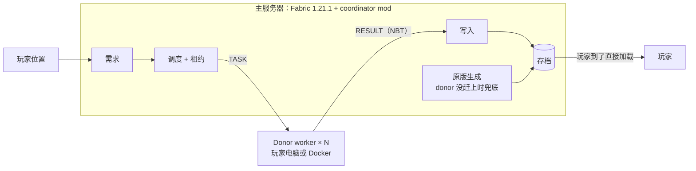

# mc-donate：让玩家帮 Minecraft 服务器生成地图

玩家探索新区域时，服务器要实时生成地形（chunk）。这是很多小服务器卡顿的主要原因。本项目让在线玩家的电脑捐出空闲算力：提前帮服务器生成玩家前方的 chunk，服务器到时直接从磁盘加载。

玩家的电脑不可信、会随时掉线、玩家自己还在打游戏。所以项目的重点是三件事：

- **调度**：按玩家的移动方向和速度，决定哪些 chunk 先算、交给谁算，有人掉线也不丢任务。
- **验证**：作弊的 donor（比如往地里塞钻石、把地形压平）能被发现并回滚。
- **不卡捐赠者**：按 donor 自己的帧率限速。

> **状态**：本 checkout 第 0 步实现及运行验收完成，87 项通过、无 skip；Git 提交、同步上游后复验及合入 main 待提交身份。证据和当前 checkout 的范围见 [验收记录](docs/step0-plan.md)，开发顺序见 [DEV_PLAN.md](DEV_PLAN.md)。

## 怎么工作



1. **找需求**：服务器每秒扫一遍每个玩家周围“视距 + 4 圈”内还没生成的 chunk，按 4×4 的 tile 放进队列。
2. **领任务**：空闲的 donor 领一个 tile，同时拿到 30 秒的租约。超时或断线，服务器就收回重发。
3. **生成**：donor 是一个用同一个 seed 的精简 Fabric 服务器。它把 tile 生成完，连同外圈的半成品 chunk 一起导出成 NBT 发回。
4. **写入**：服务器在主线程检查这个 chunk：自己没加载、也没在生成，就写进存储；否则丢掉。
5. **加载**：玩家飞到时，原版直接从磁盘读到现成的 chunk。donor 没赶上的，服务器照常自己生成。

所有 donor 都掉线时，服务器就是原版，所以 donor 只是加速器。

## 研究假设

> 在一台 2 核的服务器上，由 N 个志愿玩家分担 chunk 生成，可以把 p95 chunk 就绪延迟降低 X 倍，MSPT 保持在 50ms 以下；同时验证机制能抓到 ≥99% 的篡改 chunk，验证成本不超过本地生成的 Y%，捐赠者帧时间增加不超过 Z%。

X、Y、Z 在阶段 0 测完基础数据后再定。

## Benchmark（ChunkBench-mini）

| 层 | 回答什么 | 怎么测 | 主要指标 |
| --- | --- | --- | --- |
| 第 1 层：生成吞吐 | 一个 chunk 要多少算力 | Chunky 预生成固定区域（海洋 / 山地 / 丛林，各 16×16 chunk），限 1 / 2 / 4 核 | 每秒生成的 chunk 数、每个 chunk 的 CPU 毫秒数、各阶段占比、不确定率 |
| 第 2 层：飞行探索 | 玩家眼前的地形能不能及时出来 | Carpet 假玩家从出生点直线移动（走路 4.3 / 骑马约 14 / 鞘翅约 30 格每秒），视距 10，每轮 120 秒 | 虚空率、chunk 就绪延迟 p50/p95/p99、MSPT、服务器 CPU |

- **虚空率**：视距内还没加载的 chunk 比例，也就是玩家看到的“前面一片空白”。
- **可持续探索容量**：虚空率保持在 5% 以下时，最多撑得住几个鞘翅玩家。这是项目最后的汇总指标。
- 每个配置跑 5 次，每轮用全新世界和同一个 seed，先预热 JVM。
- TNT 和实体负载只作为可选的背景负载，用来展示省下的 CPU 对主线程的影响。

## 技术栈

| 组件 | 版本 |
| --- | --- |
| Minecraft | 1.21.1 |
| Mod 加载器 | Fabric（Mojang 官方名字 + Parchment 参数名） |
| Java | 21 |
| Carpet（假玩家） | 1.4.147 |
| Chunky（预生成） | 1.4.23 |
| spark（性能采样） | 1.10.109 |
| 运行环境 | Docker（用 `--cpus` 限核，`tc netem` 加网络延迟） |
| 分析 | Python |

选 1.21.1 是因为上面这些工具都支持它、教程最多，而且和同类 mod OmniGen 是同一个版本，方便对比。

## 仓库结构（计划）

```
mc-donate/
  common/        协议：消息格式、NBT 打包（服务器和 donor 共用）
  coordinator/   服务器 mod：需求、调度、写入、验证
  worker/        donor mod：领任务、生成、导出
  client/        客户端 mod：启动 worker、按帧率限速（阶段 5）
  bench/         测量 mod、假玩家场景、实时地图
  docker/        镜像和 compose 文件
  analysis/      Python：跑实验矩阵、画图
```

## 快速开始

现已提供 [Docker Compose 配置](docker/compose.yaml)，运行 Minecraft Java 版 **1.21.1**、Java **21**、Fabric Loader **0.16.14**，以及上表指定版本的 Carpet、Chunky、spark。Chunky 的依赖 Fabric API 固定为 **0.116.6+1.21.1**。分布式生成 mod 尚未实现。

### 首次准备

需要 Docker Engine 和 Compose 插件；Java 在容器内运行，本机不用安装 Java。安装方式见 [Docker 官方文档](https://docs.docker.com/engine/install/ubuntu/)。

在仓库根目录运行：

```bash
docker --version
docker compose version
cd docker
```

如果还没有 `.env`，复制 `.env.example` 为 `.env`，并生成控制台密码：

```bash
cp -n .env.example .env
python3 -c 'import secrets; print(secrets.token_hex(24))'
chmod 600 .env
```

把生成的密码填入 `.env` 的 `RCON_PASSWORD`。首次启动前，运行者需要自己阅读并同意 [Minecraft EULA](https://aka.ms/MinecraftEULA)，然后将 `.env` 中的 `EULA=FALSE` 改成 `EULA=TRUE`。自动部署时若已生成 `.env`，直接使用现有文件。

### 启动和连接

以下命令均在 `docker/` 目录运行：

```bash
docker compose up -d --wait --wait-timeout 600
docker compose ps
docker compose logs -f --tail=100 minecraft
```

第一次启动会下载 Java 镜像、Minecraft、Fabric 和模组，然后生成出生点。状态变为 `healthy` 后，用 **Minecraft Java 版 1.21.1** 连接 `服务器IP:25565`；在服务器本机玩可使用 `localhost:25565`。启用了正版账号验证，未设置管理员。上述模组用于服务端基础测试，不要求客户端安装。

默认使用 **2 核 CPU 配额、512 MiB 初始堆、1536 MiB 最大堆、2304 MiB 容器内存上限**，视距 10、模拟距离 6、最多 8 人。当前内存配置用于在已有服务的主机上启动和小规模验证；正式 benchmark 应确保主机资源充足，并为每轮实验保持相同的内存设置。

世界种子默认 `424242`，存档、配置和模组保存在 `docker/data/`。容器重建或 `docker compose down` 都会保留该目录。容器设置为 `unless-stopped`：Docker 启动后会自动恢复运行，手动停止的容器不会自动恢复。

### 常用管理命令

```bash
# 停服并保存世界 / 再次启动
docker compose stop
docker compose up -d

# 查看资源使用情况
docker compose stats --no-stream

# 进入控制台（输入命令时不带 /；Ctrl+D 退出）
docker compose exec minecraft rcon-cli

# 单条控制台命令；把 YourMinecraftName 换成自己的游戏名
docker compose exec minecraft rcon-cli list
docker compose exec minecraft rcon-cli op YourMinecraftName
docker compose exec minecraft rcon-cli chunky help
docker compose exec minecraft rcon-cli spark tps
```

spark 的部分命令异步输出结果，RCON 可能立即返回空白；随后运行 `docker compose logs --tail=30 minecraft` 查看 TPS 和 tick 耗时。

RCON 密码保存在忽略提交的 `.env` 中，25575 端口只在容器网络内使用，未发布到宿主机。不要提交 `.env` 或 `data/`。

修改 `.env` 后运行 `docker compose up -d` 应用配置。例如把 `MC_CPUS` 改为 `1`、`2`、`4` 可切换限核配置；增大 `MC_MAX_MEMORY` 时也要为 `MC_CONTAINER_MEMORY` 留出 JVM 堆外内存空间。`MC_IMAGE` 可以填写拉取后的 `itzg/minecraft-server@sha256:...` 摘要以固定镜像。

更换 seed 只对新世界生效。为 benchmark 新建世界时，先停服，再同时设置新的 `MC_LEVEL`（例如 `bench-run-001`）和所需 `MC_SEED`，然后启动；旧世界会保留在 `data/` 中。不要把已生成的世界当作全新世界重复测量。

配置依据：[Fabric 容器配置](https://docker-minecraft-server.readthedocs.io/en/latest/types-and-platforms/server-types/fabric/)、[Modrinth 版本固定](https://docker-minecraft-server.readthedocs.io/en/latest/mods-and-plugins/modrinth/)。

## 路线图

第 0 步的自动验收与本节“阶段 0”的完整基线实验不同。当前可运行：

```bash
# 仓库根目录；仅首次安装依赖
python3 -m venv .venv
.venv/bin/python -m pip install -r requirements-test.txt

# 首次会生成 docker/.env.test；本人同意 EULA 后再设置 EULA=TRUE
scripts/test.sh step0             # 未同意 EULA 时会明确失败，按提示修改后重跑
# 如同机有其他 checkout，在 .env.test 中设置独立的
# MCD_TEST_PROJECT=mc-test-<名字> 和未占用的 MC_PORT

scripts/test_config.sh pin       # 需要 sudo；CPU 12–15 及 SMT 兄弟固频
scripts/test_config.sh check
scripts/test.sh step0
```

当前 checkout 使用 `mc-test-kexu`、`127.0.0.1:25567`，资源限制来自 `docker/n100.env`：4 核、CPU 12–15、容器 6g、Java 堆 4G。其他 checkout 默认 `mc-test`、25566，不能共用已有的他人实例。Docker 组变更后需重新登录或刷新组身份。

测试会先创建 A 世界及远处哨兵，再切换为同 seed 的 B 世界，验证出生区隔离、36 个 Chunky 目标、只读存档解码和重启持久化。成功后关闭容器并删除活动测试世界；失败时保留世界用于排查。JUnit、快照、各阶段日志、环境摘要和最终退出码保存于 `artifacts/step0-*`，不会提交。`--allow-skip`、筛选测试和 `MCD_KEEP_SERVER=1` 仅用于排查。

读取器 API 和限制见 [analysis/mca/README.md](analysis/mca/README.md)。离线开发可运行 `.venv/bin/python -m pytest tests/step0/test_00_mca.py tests/step0/test_00_harness.py -q`。

按 12 周估算，时间不同就按比例压缩。

- [ ] **阶段 0（第 1–2 周）**：Docker 环境、仓库、benchmark 第 1 层，测出每个 chunk 的成本、各阶段占比和不确定率
- [ ] **阶段 1（第 2–3 周）**：手动打通“worker 导出 → 主服务器导入 → 玩家直接加载”
  - 关卡：跑不通就切到路线 B（Minestom + 自己写的确定性生成器）
- [ ] **阶段 2（第 3–6 周）**：原型 v0，包括通信、需求、调度、租约、写入、worker、benchmark 第 2 层、实时地图
  - 完成标准：2 个 donor 时虚空率和服务器 CPU 明显下降；kill 一个 donor 不丢 chunk；连续跑 30 分钟存档无损坏
- [ ] **阶段 3（第 6–8 周）**：调度优化，包括轨迹预测和 deadline、按实测算力分配、对冲、tile 大小、等 donor 的 Mixin
- [ ] **阶段 4（第 8–10 周）**：恶意 donor 和验证，包括随机重算、按列抽样、按价值审计、自适应抽查率、拉黑和回滚
- [ ] **阶段 5（第 9–11 周）**：客户端 mod，按帧时间限速；加分项是拆分信任（矿和结构由服务器自己算）
- [ ] **阶段 6（第 11–12 周）**：完整实验矩阵、演示视频、报告

**最小完整版本**：v0 + 预测调度 + 恶意 donor + 随机整块重算。只做到这里，也能完整回答研究假设。

## 相关工作

- [OmniGen](https://modrinth.com/mod/omniworld)：同类 mod（NeoForge 1.21.1, beta），服务器过载时把生成分给玩家。页面上没写验证方法。
- [Servo（ICDCS 2023）](https://arxiv.org/abs/2305.00032)：把地形生成放到 serverless 上，worker 是可信的云函数。
- [C2ME](https://modrinth.com/mod/c2me-fabric)：单机多线程生成；页面说明原版生成不完全确定。
- [Meterstick（ICPE 2023）](https://www.arxiv.org/abs/2112.06963)：Minecraft 类游戏的性能波动 benchmark，负载里没有“玩家往外探索”。
- [Sarmenta, Sabotage-Tolerance Mechanisms for Volunteer Computing Systems](https://groups.csail.mit.edu/cag/bayanihan/papers/ic2001/ic2001.pdf)：志愿计算里经典的抽查和信誉机制。

## 团队

| 成员 | 负责 |
| --- | --- |
| A | 需求、调度、租约、写入；之后做预测、对冲、Mixin |
| B | 导出 / 导入链路、worker；之后做客户端 mod 和限速 |
| C | 第 1 层测量、通信协议；之后做恶意 donor 和验证 |
| D | 仓库、benchmark 第 2 层、实时地图；之后做实验矩阵和画图 |
