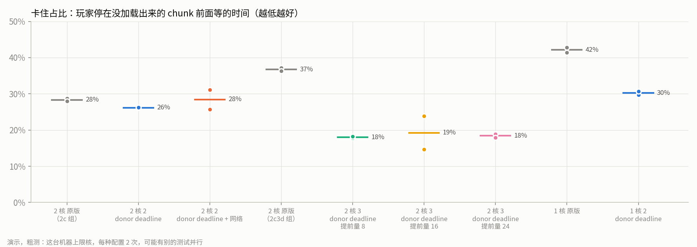
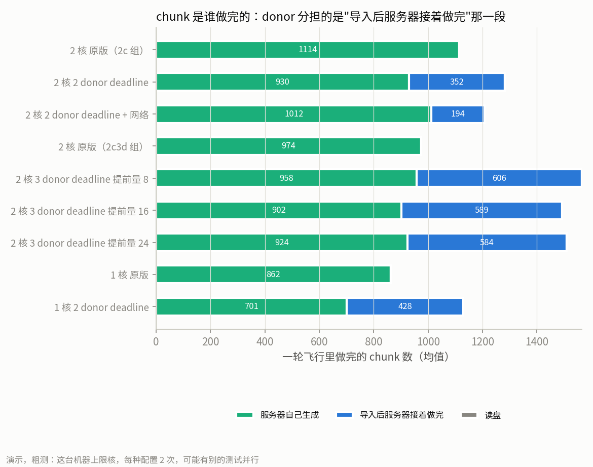
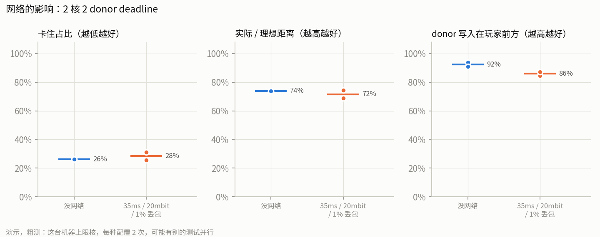
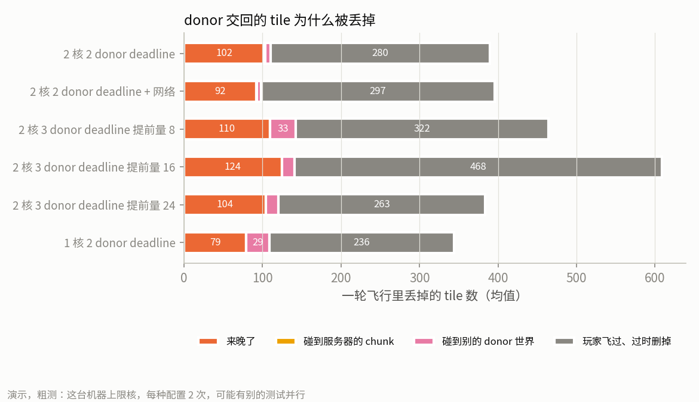

# mc-donate 演示报告

**这是课程演示，不是测量。** 下面的数都是在开发机（AMD EPYC 7542）上按 N100 限核跑的粗测：每种配置 2 次，多数轮次同时有别的测试在跑（18 轮里 14 轮"有并发"）。完整矩阵（约 41 小时，`analysis/matrix/full.json`）和部署机器上的测量留给用户以后自己做。

## 1. 项目在做什么

Minecraft 服务器在玩家探索新区域时要实时生成地形（chunk）。小服务器（比如 2 核的 N100）跟不上鞘翅飞行，玩家会停在"世界还没加载出来"的边缘等。

mc-donate 让在线玩家的电脑帮忙：

1. **找需求**：服务器每秒看一遍玩家往哪飞，把前方还没生成的区域按 4×4 chunk 的 tile 排进队列。
2. **派活**：donor（玩家电脑上的一个精简 Minecraft 服务器进程，或者 Docker 里的 worker）领 tile，用同一个 seed 生成。
3. **写入**：donor 把结果（NBT）发回来，服务器检查后写进存档；玩家飞到时原版直接从磁盘加载现成的 chunk。来晚了、碰到服务器自己已经在做的 chunk，就丢掉，服务器照常自己生成。

所有 donor 都掉线时，服务器就是原版，donor 只是加速器。作弊检测（第 8 步）这次暂停，没有接上。

## 2. 怎么演示

| 演示什么 | 用什么 | 说明 |
| --- | --- | --- |
| 服务器那边 donor 在干活 | 演示面板（`scripts/demo.sh`，浏览器 `/demo`） | 实时曲线（MSPT、TPS、服务器 CPU、虚空率、卡住占比、donor 在线数、导入和丢弃、写入在玩家前方的比例）、控制按钮、**一键 A/B**。用法见 [docs/demo.md](demo.md) |
| 谁生成了哪块 chunk | 实时地图（面板左边，或 `/` 页面） | 原版灰绿、donor 按编号分色、导入后服务器接着做完灰紫、被打回红。页面默认跟最新一轮 |
| 玩家自己的感受 | 客户端 mod（[docs/client-install.md](client-install.md)）+ 游戏内命令 | `/mcdonate show` 打开角落小地图（按来源上色、玩家朝向箭头、图例）和算力面板（自己 worker 的线程、CPU、内存、交回了多少 tile；在线 donor 数、你的贡献占比） |
| 跟踪真人玩家 | 面板的"跟踪真人玩家" | `/bench record`：只记录不移动，曲线和地图跟着这个玩家走；卡住按"没动而且视线前方 2 格内的 chunk 没就绪"近似 |

**推荐的演示流程**（约 15 分钟）：

1. 开面板，讲一遍页面上的曲线和地图。
2. 点"一键 A/B"（默认设置，见第 3 节）：两轮各换一个全新世界，A 不开 donor、B 开 3 个 donor 和 deadline，约 8～10 分钟出表格、并排曲线和两张地图回放。
3. 等的时候用客户端进服，`/mcdonate show`，飞一段，看小地图上前方的颜色。

## 3. 主要结果

### 3.1 演示矩阵 demo-v2（11-09，`analysis/results/demo-v2/`）

鞘翅 30 格/秒、120 秒，每种配置 2 次。原版的卡住占比随机器负载变（同一天 25%～43%），所以分三组，每组有自己的原版对照，同组同一次的单元紧挨着跑（原版先）。

| 配置 | 卡住占比（两次） | 实际 / 理想距离 | 成对降幅（两次） | donor 写入在玩家前方 | 导入后服务器接着做完的占比 |
| --- | --- | --- | --- | --- | --- |
| 2 核 原版（2c 组） | 28.7%、28.0% | 0.72 | — | — | 0 |
| 2 核 2 donor deadline | 26.1%、26.2% | 0.74 | 2.5、1.8 个百分点 | 92% | 28% |
| 2 核 2 donor deadline + 网络 | 31.1%、25.7% | 0.72 | （看网络影响，不参加挑选） | 86% | 16% |
| 2 核 原版（2c3d 组） | 37.2%、36.3% | 0.63 | — | — | 0 |
| **2 核 3 donor deadline 提前量 8** | **18.2%、17.8%** | **0.82** | **19.0、18.5** | **95%** | **39%** |
| 2 核 3 donor deadline 提前量 16 | 14.7%、23.8% | 0.81 | 22.5、12.5 | 89% | 39% |
| 2 核 3 donor deadline 提前量 24 | 18.0%、18.9% | 0.82 | 19.2、17.4 | 90% | 39% |
| 1 核 原版 | 42.8%、41.4% | 0.58 | — | — | 0 |
| 1 核 2 donor deadline | 29.7%、30.7% | 0.70 | 13.1、10.8 | 97% | 38% |

3 个 donor 是 worker、worker2（各 4 核）加 worker3（提到 4 核）。调度要的是 4 个，但 compose 里只有这三个 donor 服务，第 4 个要改 compose。

**演示默认选"2 核、3 个 donor、deadline、提前量 8"**。规则是事先定的：同组同一次的原版卡住占比减有 donor 的（成对降幅），每种配置取两次里小的那个，最大的胜出。它两次都降了 18.5 个百分点以上，卡住时间大约减半（37% → 18%），实际飞行距离从理想的 63% 升到 82%；提前量 16 有一次降得更多（22.5），但另一次只降 12.5，不够稳；24 和 8 差不多。第二名是 1 核（降 11～13 个百分点）。2 核只有 2 个 donor 时几乎看不出差别（降 2 个百分点左右），所以演示一定要 3 个 donor。

**donor 分担了多少**：默认设置下，一轮里约 39% 的 chunk 是 donor 导入、服务器接着做完的，95% 写在玩家前方。服务器自己生成的 chunk 数和原版差不多（958 对 974），省下的不是服务器的活，而是玩家等的时间：donor 把前方那一段提前做好了。

**网络的影响**：2 个 donor 时加上 35ms 延迟、20mbit 限速、1% 丢包，原本就很小的改善（2 个百分点）没了，donor 导入占比从 28% 降到 16%。fish 第 7 步的对比里也看到网络让每个结果晚约 0.5 秒，主要是丢包重传。

**丢掉的 tile**：最多的是"玩家已经飞过、过时删掉"（deadline 的 7.2，每轮几百个），其次是"来晚了"（每轮约 100 个），碰到服务器 chunk 的几乎没有。fish 拆开看过耗时：donor 从领到 tile 到交回只要约 1.4 秒，时间都花在 coordinator 的队列里排队（p50 4～10 秒，p90 22～43 秒）。fish 在做"来不及的 tile 不派、最前面的先派"（importFrontier），初测 2 个 donor 时卡住从 23.4%、18.9% 降到 10.3%、7.6%，等它进 main 后会在同一批里再确认一次。

### 3.2 之前几步的数

- **第 4 步原版基线**（`analysis/results/baseline-layer2.md`）：2 核鞘翅卡住 30～34%，实际距离是理想的 66～70%；4 核几乎不卡；走路、骑马不卡。
- **第 7 步快速对比**（`docs/step7-report.md`，fish）：deadline 把 2 核鞘翅卡住从同批原版的 38～43% 降到 23～24%；有网络时 26～28%。
- **一次正式演示 A/B**（11-09，2 核、2 个 donor、deadline，各 1 次）：A 卡住 25.3%，B 27.7%，没有改善。这正是后来改成 3 个 donor、并且要求成对相邻地跑的原因。

### 3.3 研究假设汇总

| 条目 | 结果 | 判定 |
| --- | --- | --- |
| X（p95 就绪延迟降低几倍） | 0 donor 和 donor 两边的 p95 都是无穷大（有 chunk 直到出视野都没就绪），比值不硬算 | 数据不足 |
| 卡住占比（和 X 并列） | 默认设置 37% → 18%，成对降 19.0、18.5 个百分点；2 核 2 donor 26% 对 28% | 记录 |
| donor 分担 | 默认设置 39% 的 chunk 是 donor 导入后服务器接着做完的 | 记录 |
| MSPT < 50 ms | 2 核所有轮次"每秒 MSPT 均值"的 p95 最差 10.7 ms（每秒最大值 199 ms，是单个 tick） | 成立 |
| 作弊检出率 ≥ 99% | 第 8 步暂停，没有接上 | 数据不足（第 8 步暂停） |
| Y（验证成本） | 同上 | 数据不足（第 8 步暂停） |
| Z（捐赠者帧时间增加） | 这台机器没有显卡，测不了 | 数据不足（要真显卡） |

X 用 p95 就绪延迟，鞘翅 2 核下两边都有删失，所以演示里用卡住占比和实际 / 理想距离说话，这两个是玩家直接能感觉到的。

## 4. 已知限制

- **粗测**：每种配置 2 次，多数轮次有并发；没有置信区间。同一天原版的卡住占比就在 25%～43% 之间变，所以只和同组紧挨着跑的原版比。
- **donor 和服务器在同一台机器上**：都限了核、分开了 NUMA 节点，但共用磁盘和 Docker。真实部署里 donor 在别人的电脑上。
- **3 个 donor 而不是 4 个**：compose 里只有 worker、worker2、worker3。
- **作弊检测没接上**（第 8 步暂停），donor 交回的结果只查了格式和"有没有碰到别人的 chunk"。
- **跟踪真人玩家的卡住是近似**："这个 tick 没动，而且视线前方 2 格内的 chunk 没就绪"，玩家因为别的原因停在边缘也会算进去。
- **游戏内小地图**：开服以前就有、不是 donor 导入的 chunk 不知道是谁生成的，不画；地面上的彩色 chunk 边框是第二期。画得对不对只有用户在真客户端上看过，自动测试（无头客户端不渲染）只验证收到数据。
- **帧时间（Z）没测**：要有显卡的电脑，用 fish 的挂机脚本（`docs/step9-plan.md` 9.7）。
